# Wave Function Collapse Lab

[日本語](README.md) | **English**

A browser demo that generates small villages with Wave Function Collapse (WFC) and lets you watch the algorithm one step at a time.
It is a JavaScript implementation of the socket-based, two-pass algorithm from [SpriteCook's “Wave Function Collapse Explained”](https://www.spritecook.ai/blog/wave-function-collapse-explained).

### ▶ [Play in your browser](https://kumi0708.github.io/wave-function-collapse-lab/)

| Day | Night |
|---|---|
| 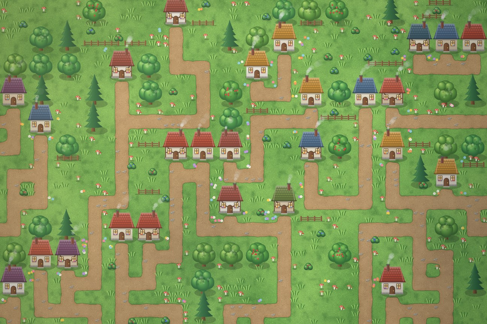 | 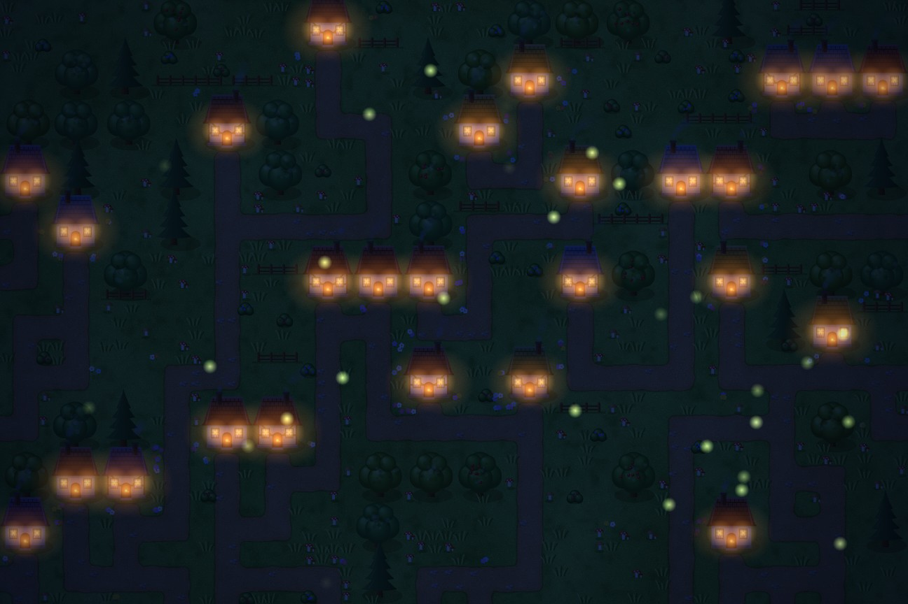 |

- No dependencies: plain JavaScript and Canvas 2D.
- Every sprite is drawn in code. The project has no image assets.
- Generation is deterministic. The same seed always gives the same village, and you can share one with a `#seed=…` URL.

---

## Watch it collapse

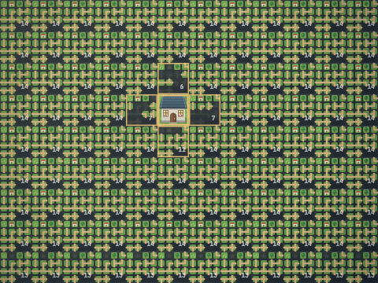

Each open cell shows small icons for the modules it can still become. Gold outlines mark the frontier, the cells that compete for the next pick. Once the layout is complete, the detail pass runs on an 8 px grid and adds flowers, pebbles, fences and more.

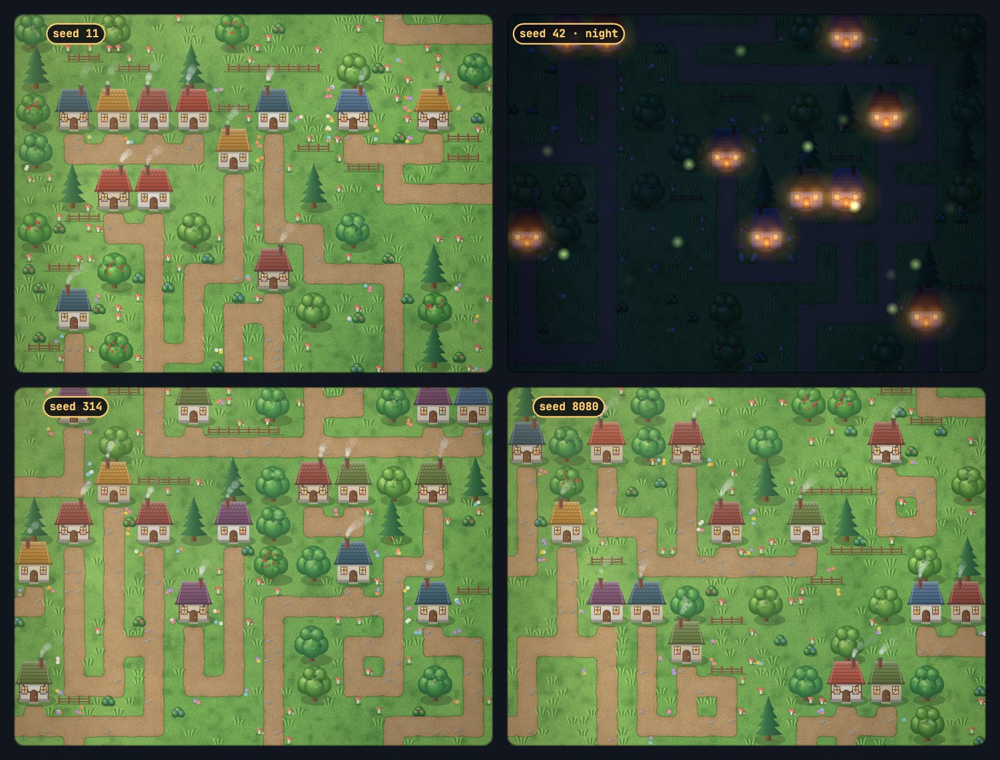

---

## How it works, illustrated

> Every figure below was rendered by this repository's own solver and renderer. See [Regenerating the figures](#regenerating-the-figures).

### 0. Code layout

```
js/solver.js   Generic WFC solver (domains, entropy, propagation, RNG)
js/village.js  Village rules (modules, sockets, weights, both passes, restarts)
js/render.js   Rendering (noise ground, procedural sprites, lighting, ambient FX)
js/app.js      UI, animation loop, URL sharing
test/          Node test suite (200 seeds)
tools/         Figure generator page and the server that saves its images
```

The solver has no village-specific logic. It takes a module count, a compatibility table, per-cell weights and initial domains, and solves the grid. Both passes run on the same solver.

### 1. Modules & sockets

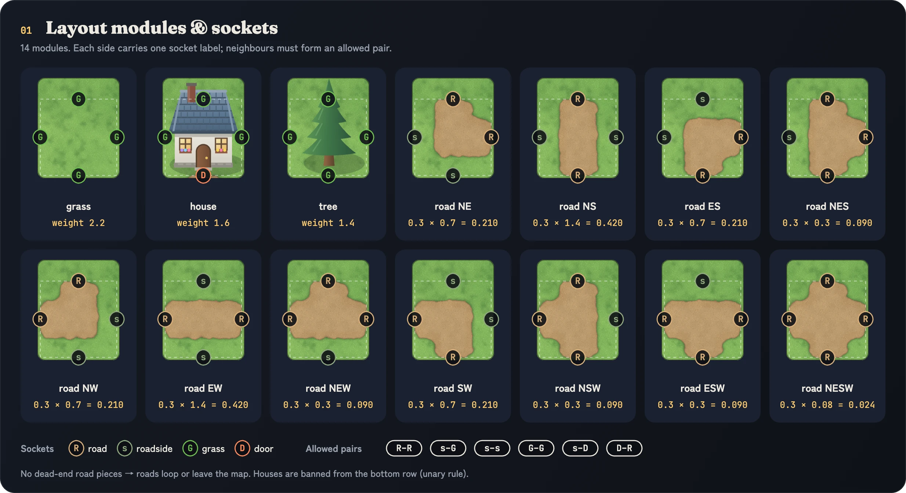

The layout pass places one of **14 modules** in each cell. A cell is the size of a 32 px tile.

- grass
- house
- tree
- 11 road pieces: every shape that connects 2–4 sides

Each module has one **socket label** on each of its four sides (N/E/S/W):

| Socket | Meaning |
|---|---|
| `R` | a side where the road continues |
| `s` | roadside: a road piece's unconnected side |
| `G` | grass |
| `D` | a house's front door (its south side) |

A module's **weight** sets how likely it is to be picked. Each road piece weighs `0.3 × shape factor`, where the factor is 1.4 for straight, 0.7 for corner, 0.3 for T and 0.08 for crossing.

### 2. Adjacency = socket pairs

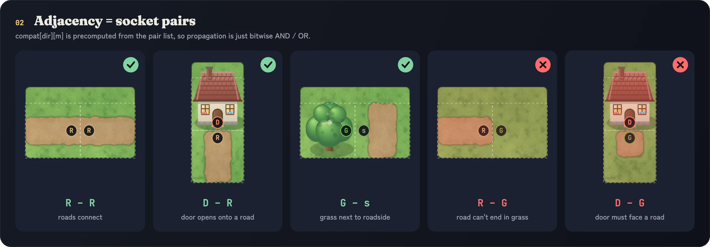

Only six socket pairs are allowed: `R–R`, `s–G`, `s–s`, `G–G`, `s–D` and `D–R`. The solver precomputes a table from this list:

```
compat[dir][m] = bitmask of modules that may sit next to module m in direction dir
```

- The door socket `D` only touches `R` or `s`, so every house has a road piece below it.
- There are no dead-end pieces, so roads either loop or leave the map.
- **Unary rule:** no houses in the bottom row, because the door would have no room for a road.

### 3. Observe → propagate, frontier first

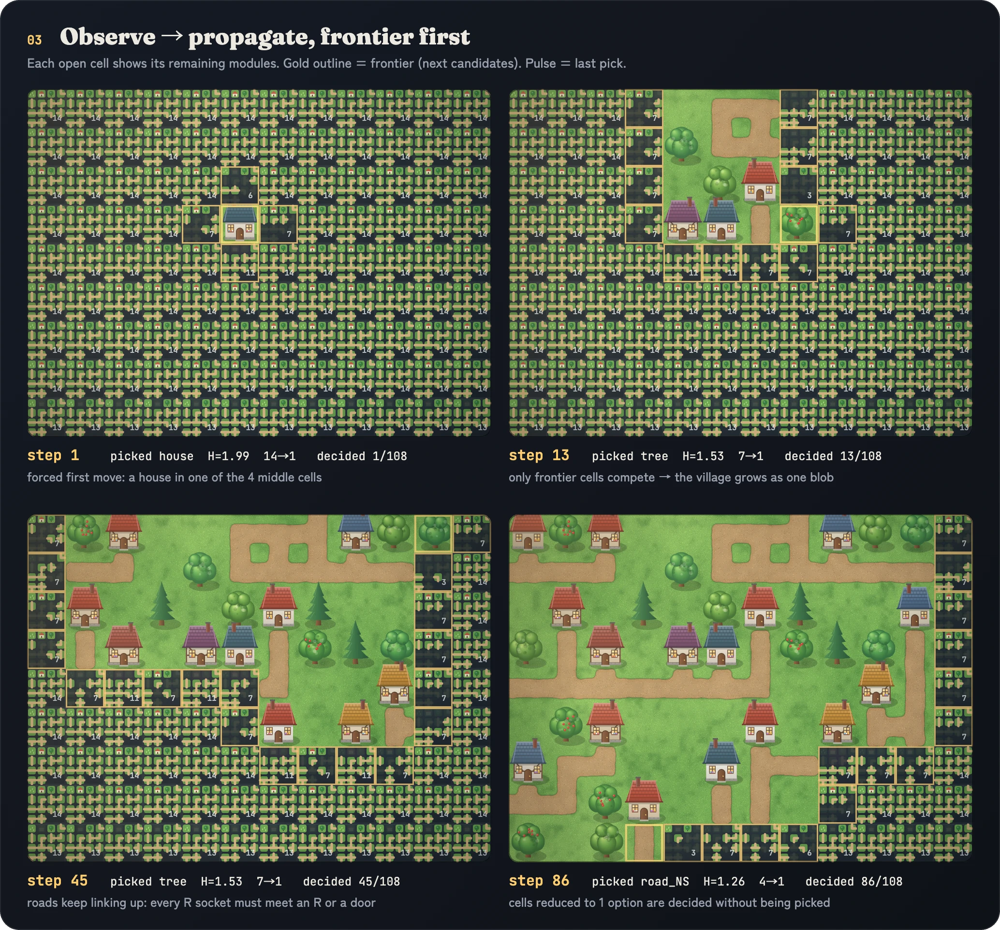

Each step does three things:

1. **Observe (pick a cell).**
   - Only open cells next to a decided cell, the **frontier** (gold outlines), compete.
   - The solver picks the frontier cell with the lowest `H + rng()×0.05`, where H is the cell's entropy and the noise breaks ties.
   - If the frontier is empty, it considers all open cells.
2. **Collapse (pick a module).** It picks a module at random, weighted by that cell's weights.
3. **Propagate.** It spreads constraints from the collapsed cell, using a stack:

```
pop c
for each direction d:
    support = OR{ compat[d][m] | m ∈ domain[c] }   ← memoized per (d, domain)
    new = domain[nb] & support
    if new changed:
        new == 0 → contradiction
        domain[nb] = new; push nb
```

More details:

- **Forced first move:** a house goes into one of the four middle cells, so the village grows outward as a single blob.
- A cell that propagation reduces to one option counts as decided, even though it was never picked.
- **Domains are bitmasks.** Each one is a single `Int32Array` entry, where bit *m* means module *m* is still possible. Propagation therefore needs only bitwise `AND` and `OR`.

### 4. Seeing the wave: options & entropy

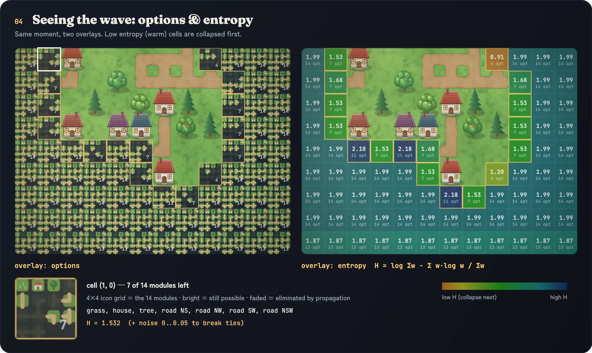

**Shannon entropy** is computed from the weights *w* of the remaining options:

```
H = log(Σw) − (Σ w·log w) / Σw
```

- A cell with one option has H = 0.
- The value is cached and recomputed only when the cell's domain changes.
- The app has two overlays for open cells:
  - **Options** shows the 14 modules as a 4×4 icon grid and fades the ones that propagation removed.
  - **Entropy** shows a heatmap. Warm cells have low entropy and are collapsed first.

### 5. Designing the weights

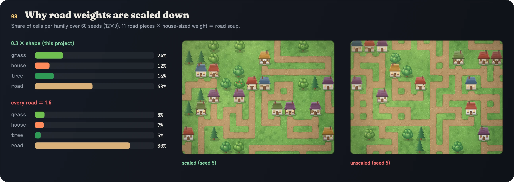

There are 11 road pieces. If each one gets a house-sized weight (1.6), their combined weight swamps everything else, and roads fill about 80% of the map (right). This project scales each road piece down to `0.3 × shape factor` (left).

### 6. Detail pass: the same solver, run again

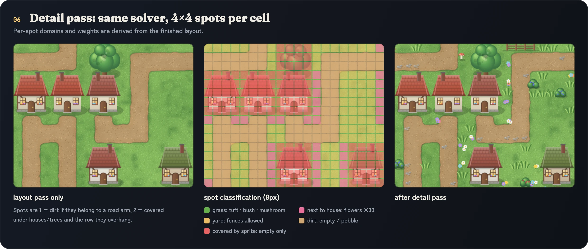

Each layout cell is split into **4×4 spots** (8 px each), and the same solver runs again with 10 modules:

`empty, flower, mushroom, tuft, pebble, bush, and 4 fence pieces`

Each spot's options and weights come from the finished layout:

| Spot class | What it allows |
|---|---|
| Dirt (center 2×2 and arms of a road cell, and the path to each door) | empty or pebble |
| Covered (under a house or tree, and the row its sprite overhangs) | empty only |
| Next to a house | flowers, with weight 2.2 (about 30× more likely than elsewhere) |
| Yard (the cells around a house) | fences |
| Near a tree | more mushrooms |

The pass starts at the grass spot nearest the first house's door.

### 7. Fence sockets form a grammar

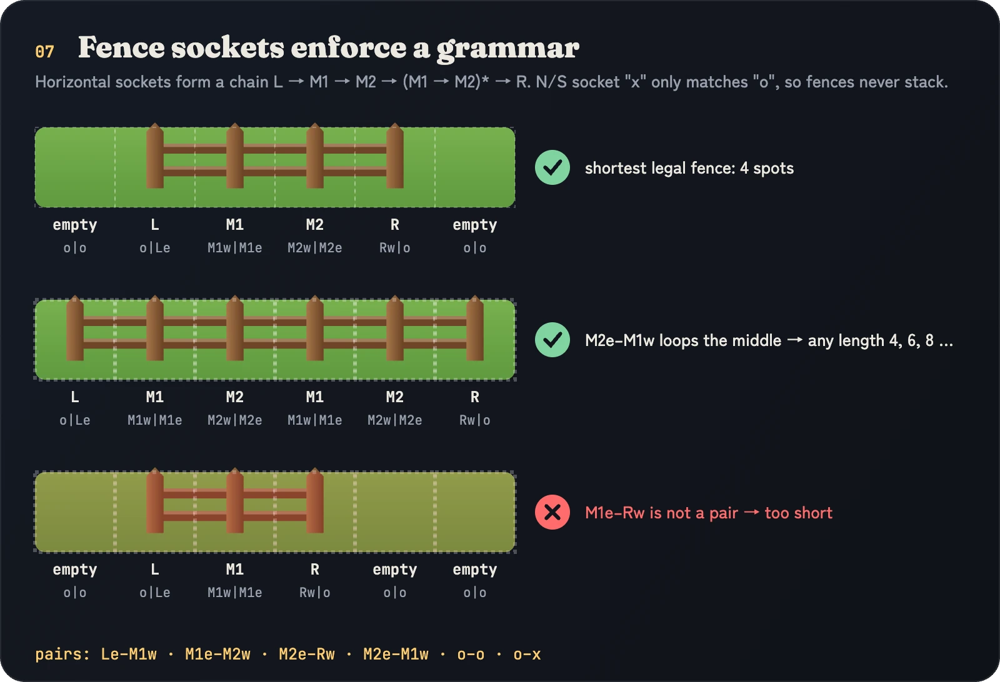

Fence pieces only connect sideways:

| Piece | W side | E side |
|---|---|---|
| left end `L` | `o` | `Le` |
| middle 1 `M1` | `M1w` | `M1e` |
| middle 2 `M2` | `M2w` | `M2e` |
| right end `R` | `Rw` | `o` |

The allowed pairs are `Le–M1w`, `M1e–M2w`, `M2e–Rw` and `M2e–M1w`. With these pairs, every fence matches the pattern `L M1 M2 (M1 M2)* R`.

- Every fence starts with a left end, finishes with a right end, and spans **at least 4 spots**.
- The N/S sides of a fence use `x`, which only matches `o`, so fences never stack vertically.
- Some pieces are banned in the edge columns, so no fence is cut off by the map edge.

### 8. Ground: spots → field → shape → texture

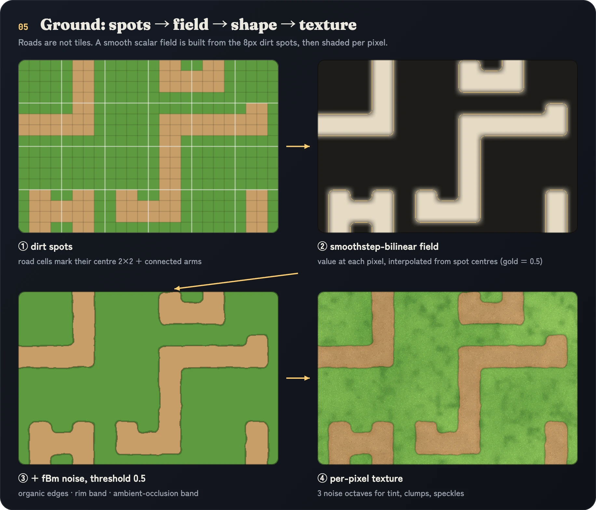

Roads are not tile images. They are drawn per pixel in four stages:

1. **Dirt spots.** In each road cell, the center 2×2 spots and an arm toward each connection are dirt.
2. **Scalar field.** The spot-center values are joined with **smoothstep-bilinear interpolation**. The road outline is the 0.5 contour, and its corners come out rounded, much like a dual grid.
3. **Noise and threshold.** fBm value noise roughens the edges before the 0.5 cut. Bands near the edge add a dark rim on the road side and ambient occlusion on the grass side.
4. **Texture.** Three noise frequencies add tint, clumps and speckles, written straight into `ImageData`.

Only the area around newly decided cells is recomputed and uploaded with a dirty-rect `putImageData`, so the animation stays smooth.

### 9. Sprites & lighting

| Part | Technique |
|---|---|
| Houses | Hip roofs with gradients, shingle rows, ridge lines and side shading. Also timber framing, a stone base, windows with flower boxes, an arched door and a chimney. Roof color, wall color, width and chimney side vary with a hash of the cell coordinates. |
| Trees | Broadleaf trees (layered radial-gradient leaf blobs, some with fruit) and conifers. |
| Details | Petals, mushroom-cap spots, curved grass blades, pebble highlights, bushes with berries, and fence posts and rails. |
| Depth | All shadows are drawn first. Sprites are then **sorted by their bottom edge** and drawn in that order. |
| Atmosphere | Drifting cloud shadows and chimney smoke particles. At night, a multiply pass darkens the scene, additive window and door glows flicker, and fireflies appear. |
| Layers | The static layer (ground, sprites and overlay) is redrawn only when the solver state changes. Clouds, smoke, night and pulses are drawn every frame. |

### 10. Contradictions & determinism

- **Contradictions.** If a domain becomes empty, the pass **restarts with the next seed** (up to 50 attempts for the layout pass, 20 for the detail pass). There is no backtracking. As in the article, the rules are designed to rarely contradict. The 200-seed test suite needs 0 restarts.
- **Determinism.** A single **Park–Miller** RNG (`state = state × 16807 mod (2³¹−1)`) drives the tie-break noise, the module picks and the forced first move.

---

## Controls

| Control | What it does |
|---|---|
| **▶ 生成を観察** (Watch) | Generates the village step by step, with animation |
| **⚡ 即時生成** (Instant) | Generates the whole village at once |
| **⏭ 1ステップ** / `→` | Advances one step |
| `Space` | Play / pause |
| `R` / 🎲 | Generates with a random seed |
| `N` | Switches between day and night |
| **候補 / エントロピー / なし** | Overlay for open cells: options, entropy, or none |
| **8px グリッド** | Shows the detail-pass spots and the open ones |
| **ディテール層** | Shows or hides the detail layer, so you can compare before and after the detail pass |
| **⤓ PNG** | Saves the current view as a PNG |

## Run locally

No build step is needed. The scripts are plain `<script>` tags, so opening `index.html` directly works. To serve the folder instead, run:

```bash
npx http-server . -p 8080
```

## Tests

```bash
node test/village.test.js
```

The suite generates 200 villages (18×12) and checks that:

- every seed finishes, with no contradictions or by restarting
- the same seed gives the same result
- no house is in the bottom row, and every house has a road below it
- every road connection meets a road, a door or the map edge
- pebbles appear only on dirt, and covered spots stay empty
- every fence starts with a left end, finishes with a right end, spans at least 4 spots and never stacks vertically
- every module is placed at least once, which catches rules that silently never fire

## Regenerating the figures

Every image in this README is drawn by [`tools/figures.html`](tools/figures.html) with the real solver and renderer. To rebuild them, first start the server:

```bash
node tools/figure-server.js
```

Then open `http://localhost:8790/tools/figures.html?run=1` in a browser. The page writes WebP, JPEG and GIF files to `docs/images/`. The GIF is encoded in the browser with gifenc. All frames share one palette, and each frame stores only the pixels that changed from the previous one.

## Credits

- Algorithm design (modules, sockets, weights, two-pass structure): [SpriteCook — Wave Function Collapse Explained](https://www.spritecook.ai/blog/wave-function-collapse-explained)
- Original WFC: [mxgmn/WaveFunctionCollapse](https://github.com/mxgmn/WaveFunctionCollapse)
- GIF encoder (figure generation): [gifenc](https://github.com/mattdesl/gifenc)
