# Wave Function Collapse Lab

**日本語** | [English](README.en.md)

Wave Function Collapse（WFC）で小さな村を生成し、その過程を 1 手ずつ観察できるブラウザデモです。
[SpriteCook のブログ記事「Wave Function Collapse Explained」](https://www.spritecook.ai/blog/wave-function-collapse-explained) で解説されている、ソケット方式・2パス構成のアルゴリズムを JavaScript で実装しました。

### ▶ [ブラウザで遊ぶ](https://kumi0708.github.io/wave-function-collapse-lab/)

| 昼 | 夜 |
|---|---|
| 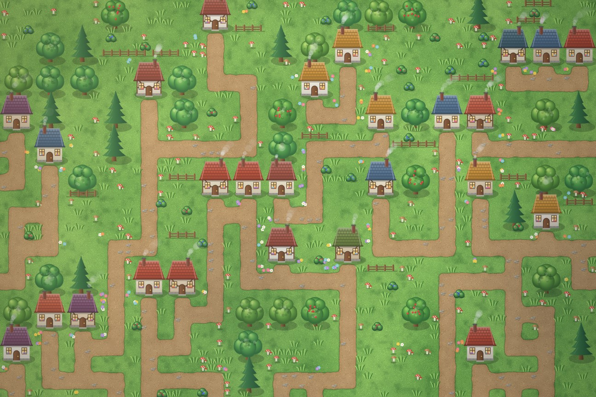 | 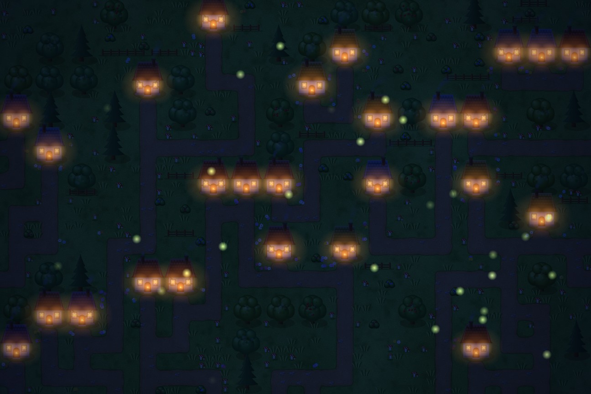 |

- 依存ライブラリなし。素の JavaScript と Canvas 2D だけで動きます
- スプライトはすべてコードで描いています（画像ファイルは使っていません）
- シードが同じなら、同じ村が生成されます（URL の `#seed=…` で共有できます）

---

## 生成の様子

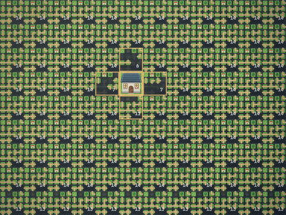

未確定のセルには、まだ取りうるモジュールが小さなアイコンで表示されます。金色の枠は次の候補（フロンティア）です。レイアウトが決まると、8px グリッド上でディテールパスが走り、花・小石・柵などが置かれていきます。

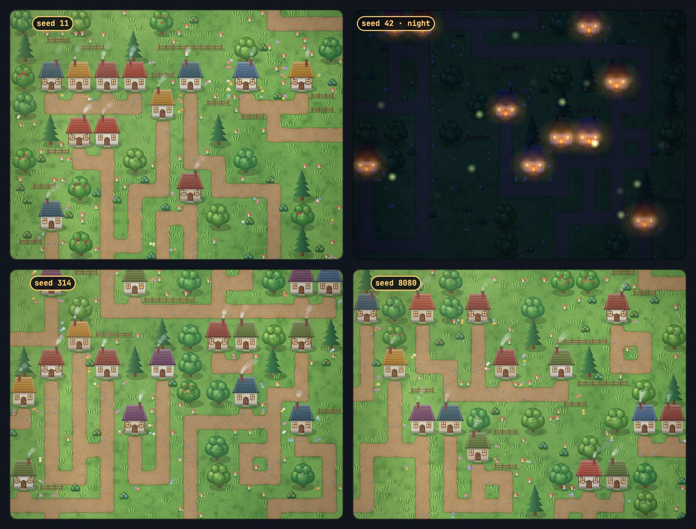

---

## しくみ（図解）

> 図の中の文字は英語です（日英の README で同じ図を使っています）。図はすべて、このリポジトリのソルバーとレンダラーで実際に生成したものです（[図の再生成](#図の再生成)）。

### 0. コードの構成

```
js/solver.js   汎用 WFC ソルバー（ドメイン・エントロピー・伝播・乱数）
js/village.js  村のルール定義（モジュール・ソケット・重み・2つのパス・再試行）
js/render.js   描画（ノイズで作る地面・手続き的スプライト・ライティング・環境アニメ）
js/app.js      UI・アニメーションループ・URL 共有
test/          Node で動く検証テスト（200シード）
tools/         README の図を生成するページと保存用サーバー
```

ソルバーは「村」のことを何も知りません。モジュール数、互換テーブル、セルごとの重み、初期ドメインを受け取って解くだけです。同じソルバーをレイアウトパスとディテールパスで使い回しています。

### 1. モジュールとソケット

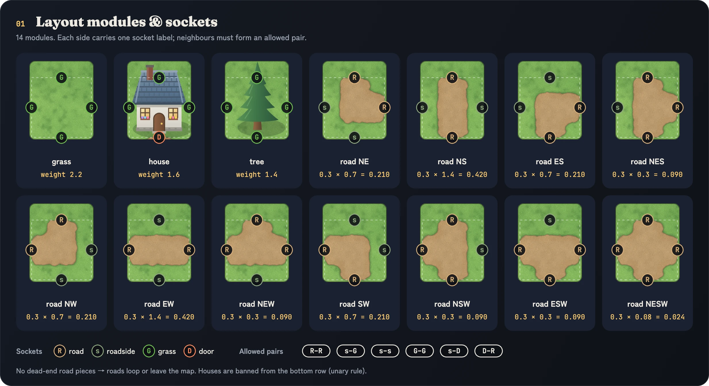

レイアウトパスでは、1 セル（32px 相当）に次の **14 モジュール** のどれかを置きます。

- 草地
- 家
- 木
- 道 11 種（2〜4 辺がつながるすべての形）

各モジュールは、4 辺（N/E/S/W）それぞれに **ソケットラベル** を 1 つずつ持ちます。

| ソケット | 意味 |
|---|---|
| `R` | 道がつながっている辺 |
| `s` | 道の路肩（道のモジュールのうち、つながっていない辺） |
| `G` | 草 |
| `D` | 家の玄関（家の南側） |

**重み** は、そのモジュールがどれだけ選ばれやすいかを決めます。道は形ごとに `0.3 × 形状係数`（直線 1.4、カーブ 0.7、T字 0.3、十字 0.08）です。

### 2. 隣接ルール = ソケットのペア

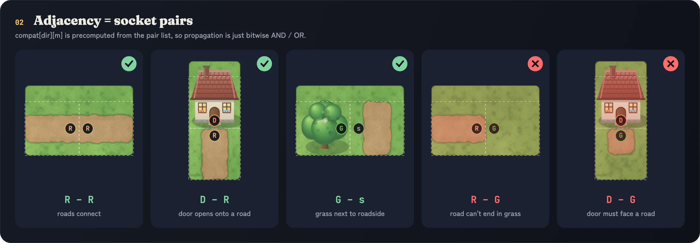

許可されるペアは `R–R`, `s–G`, `s–s`, `G–G`, `s–D`, `D–R` の 6 つだけです。このリストから、次のテーブルを事前に計算しておきます。

```
compat[dir][m] = 「モジュール m の dir 方向の隣に置けるモジュール」のビットマスク
```

- `D`（玄関）は `R` か `s` としか接しません。そのため、家の南側は必ず道になります。
- 行き止まりの道はモジュールとして用意していないので、道はループするか、マップの外へ抜けます。
- **単項ルール**: 最下段には家を置きません（玄関の前に道を置けないため）。

### 3. 観測 → 伝播（フロンティア優先）

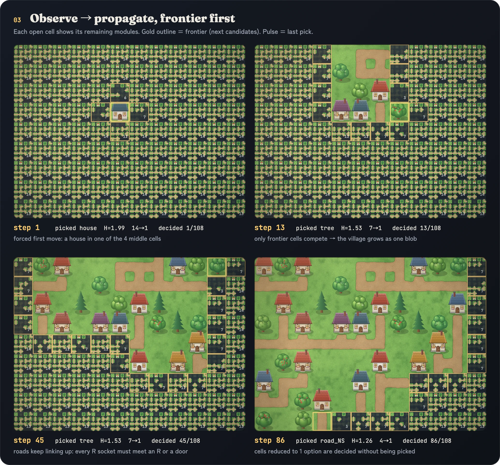

1 ステップでは次の 3 つを行います。

1. **セルを選ぶ（観測）**
   - すでに確定したセルに隣接する未確定セル（**フロンティア**、図の金枠）だけを候補にします。
   - その中から、エントロピーにノイズを足した値 `H + rng()×0.05` が最小のセルを選びます。
   - フロンティアが空のときだけ、未確定のセル全体から選びます。
2. **モジュールを決める（収束）**: そのセルの重みに従って、重み付きで抽選します。
3. **伝播**: 確定したセルからスタックで制約を広げます。

```
pop c
for 4 方向 d:
    support = OR{ compat[d][m] | m ∈ domain[c] }   ← (d, domain) ごとにメモ化
    new = domain[nb] & support
    new が変わったら:
        new == 0 → 矛盾
        domain[nb] = new; nb を push
```

補足です。

- **最初の一手**: 中央の 4 セルのどれかに家を固定で置きます。そのため、村は 1 つの塊として外側へ育ちます。
- 伝播の結果、候補が 1 つになったセルは、選ばれなくても「確定」として扱います。
- **ドメインはビットマスク** で持ちます（`Int32Array`。ビット *m* が立っていればモジュール *m* がまだ候補）。そのため、伝播はビット演算の `AND` / `OR` だけで済みます。

### 4. 「波」を見る：候補とエントロピー

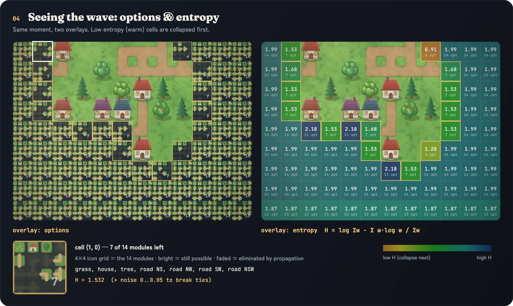

**シャノンエントロピー** は、残っている候補の重み *w* から計算します。

```
H = log(Σw) − (Σ w·log w) / Σw
```

- 候補が 1 つになったセルは H = 0 です。
- 値は、ドメインが変わったときだけ再計算します（ダーティフラグによるキャッシュ）。
- アプリでは、未確定セルの表示を「候補」と「エントロピー」で切り替えられます。
  - 候補: 14 モジュールを 4×4 のアイコンで表示し、伝播で消えた候補は薄く表示します。
  - エントロピー: 値の低い（暖色の）セルほど先に確定します。

### 5. 重みの設計

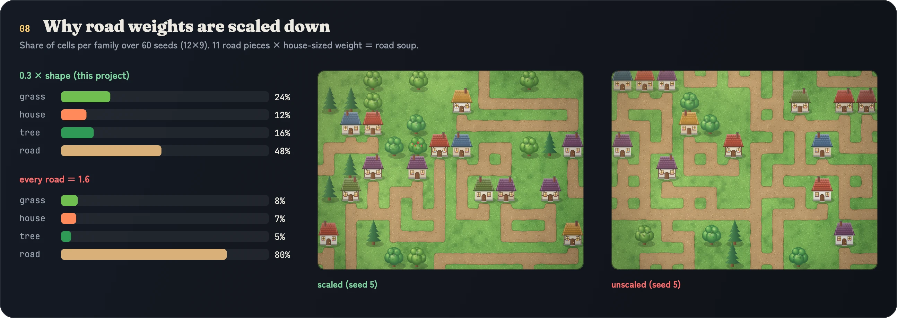

道は 11 種類もあります。1 種類ずつに家と同じくらいの重み（1.6）を与えると、道の合計の重みが大きくなりすぎます。その結果、マップの 8 割が道で埋まってしまいます（右）。そこで、道は 1 種類あたり `0.3 × 形状係数` まで重みを小さくしています（左）。

### 6. ディテールパス：同じソルバーをもう一度回す

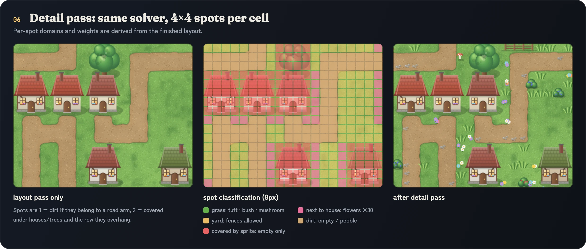

レイアウトの 1 セルを **4×4 スポット**（8px 相当）に分け、10 種類のモジュールで同じソルバーをもう一度回します。

`空き / 花 / キノコ / 草むら / 小石 / 茂み / 柵 4 種`

スポットごとの候補と重みは、確定したレイアウトから決めます。

| 地面の分類 | 置けるもの |
|---|---|
| 土（道の中央 2×2 と腕、玄関前の小道） | 空き / 小石 |
| 覆われている（家・木の下、スプライトがはみ出す 1 段上） | 空きのみ |
| 家のすぐ隣 | 花の重み 2.2（ほかの場所の約 30 倍） |
| 庭（家の周囲 1 セル） | 柵を置ける |
| 木の近く | キノコが多い |

開始地点は、最初の家の玄関に一番近い草のスポットです。

### 7. 柵のソケットは「文法」になる

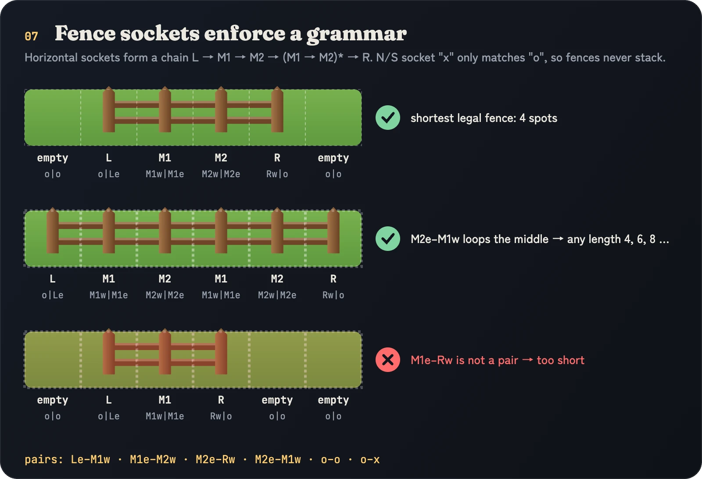

柵には、横方向にだけつながるソケットを持たせています。

| 柵のピース | W 側 | E 側 |
|---|---|---|
| 左端 `L` | `o` | `Le` |
| 中 1 `M1` | `M1w` | `M1e` |
| 中 2 `M2` | `M2w` | `M2e` |
| 右端 `R` | `Rw` | `o` |

許可ペアは `Le–M1w`, `M1e–M2w`, `M2e–Rw`, `M2e–M1w` です。これで、柵は正規表現 `L M1 M2 (M1 M2)* R` で表せる形だけになります。

- 柵は必ず左端で始まって右端で終わり、**長さは 4 スポット以上** になります。
- 柵の N/S 側は `x` で、`x` は `o` としか接しないため、柵は縦に並びません。
- マップの端で柵が途切れないよう、端の列では一部のピースを禁止しています。

### 8. 地面：スポット → スカラー場 → 形 → テクスチャ

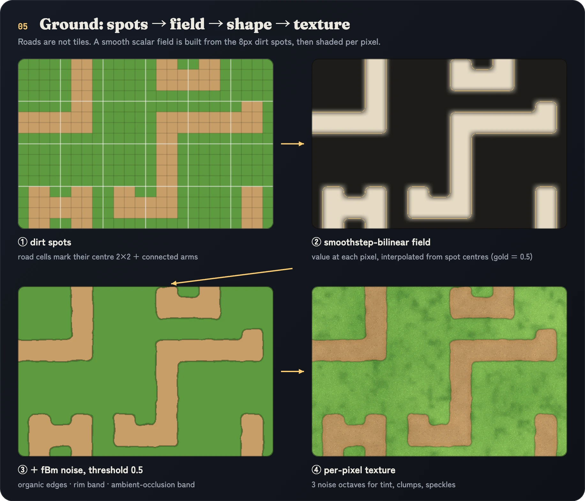

道はタイル画像ではありません。次の 4 段階で、ピクセル単位で描いています。

1. **土スポット**: 道のセルは、中央の 2×2 スポットと、つながっている方向の腕を「土」にします。
2. **スカラー場**: スポット中心の値を **smoothstep 付きの双一次補間** でなめらかにつなぎます。しきい値 0.5 の等値線が道の輪郭です（デュアルグリッドのように角が丸くなります）。
3. **ノイズとしきい値**: fBm バリューノイズを足して境界を揺らし、0.5 で切ります。境界付近の帯には、道側に暗い縁取り、草側にアンビエントオクルージョン（影）を入れます。
4. **テクスチャ**: 3 つの周波数のノイズで、色ムラ・茂みの濃淡・斑点を ImageData に直接書き込みます。

新しく確定したセルの周りだけを再計算し、`putImageData` の dirty rect で反映するので、アニメーション中も軽く動きます。

### 9. スプライトとライティング

| 要素 | 技法 |
|---|---|
| 家 | 寄棟屋根（グラデーション、瓦の列、稜線と側面の陰影）、木組みの壁、石の土台、窓と植木鉢、アーチ型の玄関、煙突。屋根の色・壁の色・幅・煙突の位置は、セル座標のハッシュで決まる個体差です。 |
| 木 | 広葉樹（放射グラデーションの葉の塊を重ねたもの。実のなる木もある）と針葉樹の 2 系統です。 |
| ディテール | 花びら、キノコの傘の斑点、草の葉のカーブ、小石のハイライト、ベリーのなった茂み、柵の杭と横木を描きます。 |
| 奥行き | 影をすべて先に描き、そのあとスプライトを **下端の y 座標でソート** して描きます。 |
| 環境 | 雲の影が流れ、煙突から煙のパーティクルが上がります。夜は乗算合成で暗くし、窓と玄関の明かりを加算合成で灯し（ちらつきあり）、ホタルを飛ばします。 |
| レイヤー | 静的レイヤー（地面＋スプライト＋オーバーレイ）は、ソルバーの状態が変わったときだけ描き直します。雲・煙・夜・パルスは毎フレーム描きます。 |

### 10. 矛盾と再現性

- **矛盾**: どこかのドメインが空になったら、そのパスを **別のシードで最初からやり直し** ます（レイアウトは最大 50 回、ディテールは最大 20 回）。バックトラックはしません。記事と同じく、ルールの側を矛盾しにくく作る方針です。200 シードのテストでは、再試行は 0 回でした。
- **再現性**: 乱数は **Park–Miller 法**（`state = state × 16807 mod (2³¹−1)`）を使い、セル選択のノイズ・モジュール抽選・最初の一手のすべてに、1 本の乱数列を使っています。

---

## 遊び方

| 操作 | 内容 |
|---|---|
| **▶ 生成を観察** | 1 手ずつアニメーションしながら生成します |
| **⚡ 即時生成** | 一瞬で完成させます |
| **⏭ 1ステップ** / `→` | 1 手だけ進めます |
| `Space` | 再生 / 一時停止 |
| `R` / 🎲 | ランダムなシードで生成します |
| `N` | 昼と夜を切り替えます |
| **候補 / エントロピー / なし** | 未確定セルの表示を切り替えます |
| **8px グリッド** | ディテールパスのスポットと、未確定スポットを表示します |
| **ディテール層** | オフにすると、レイアウトパスだけの状態と見比べられます |
| **⤓ PNG** | 今の画面を画像として保存します |

## ローカルで動かす

ビルドは不要です。スクリプトは通常の `<script>` なので、`index.html` をそのまま開いても動きます。ローカルサーバーで動かす場合は、次のコマンドを使います。

```bash
npx http-server . -p 8080
```

## テスト

```bash
node test/village.test.js
```

200 シード（18×12）を生成し、次の項目を確認します。

- 矛盾が起きない、または再試行で必ず完成する
- 同じシードから同じ結果が出る
- 最下段に家がない／すべての家の下に道がある
- 道の接続先が、道・玄関・マップの端のどれかになっている
- 小石は土の上にだけある／覆われたスポットには何も置かれていない
- 柵は左端で始まって右端で終わり、長さが 4 以上で、縦に並んでいない
- 一度も配置されないモジュールがない（ルールが知らないうちに死んでいないかの確認）

## 図の再生成

README の図はすべて [`tools/figures.html`](tools/figures.html) が実際のソルバーとレンダラーで描いています。作り直すときは、まずサーバーを起動します。

```bash
node tools/figure-server.js
```

起動したら、ブラウザで `http://localhost:8790/tools/figures.html?run=1` を開きます。`docs/images/` に WebP、JPEG、GIF が書き出されます。GIF は gifenc でブラウザ上でエンコードしています（全フレームで共有パレットを使い、前のフレームとの差分だけを書き込みます）。

## クレジット

- アルゴリズムの設計（モジュール、ソケット、重み、2パス構成）: [SpriteCook — Wave Function Collapse Explained](https://www.spritecook.ai/blog/wave-function-collapse-explained)
- WFC のオリジナル: [mxgmn/WaveFunctionCollapse](https://github.com/mxgmn/WaveFunctionCollapse)
- GIF エンコーダー（図の生成用）: [gifenc](https://github.com/mattdesl/gifenc)
